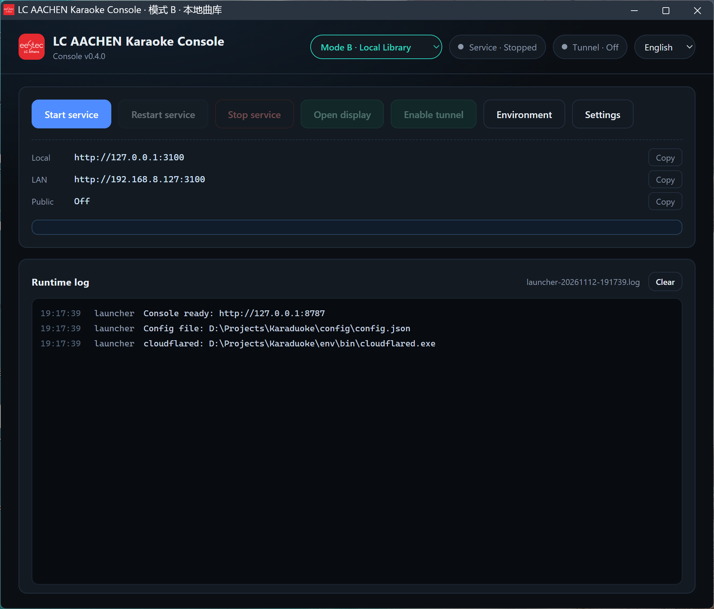
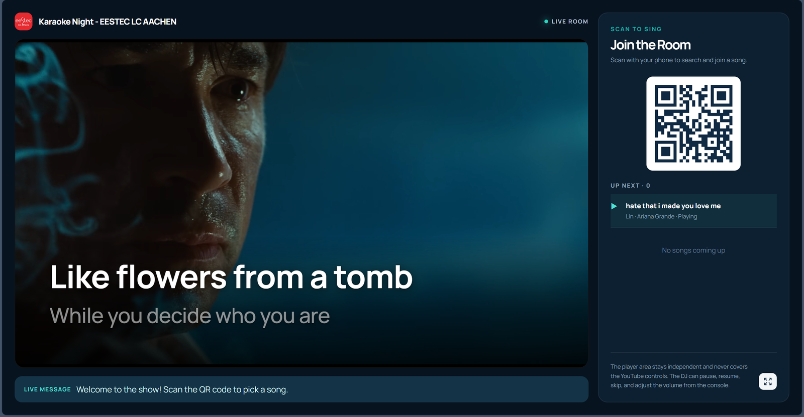
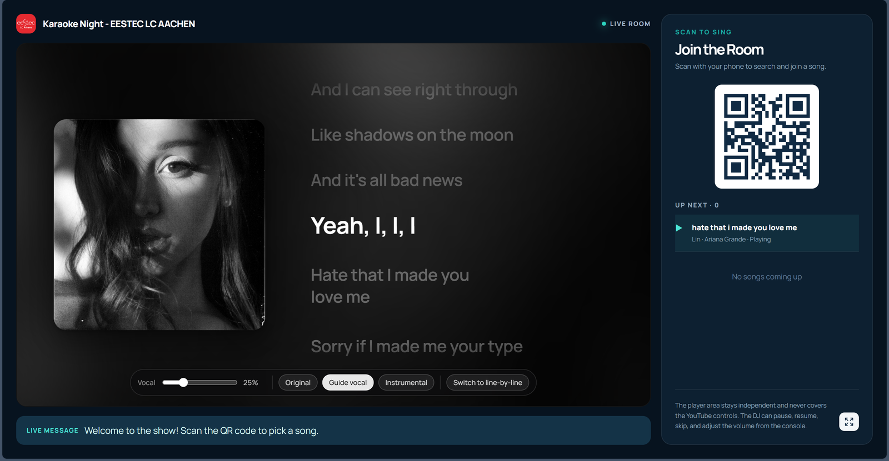
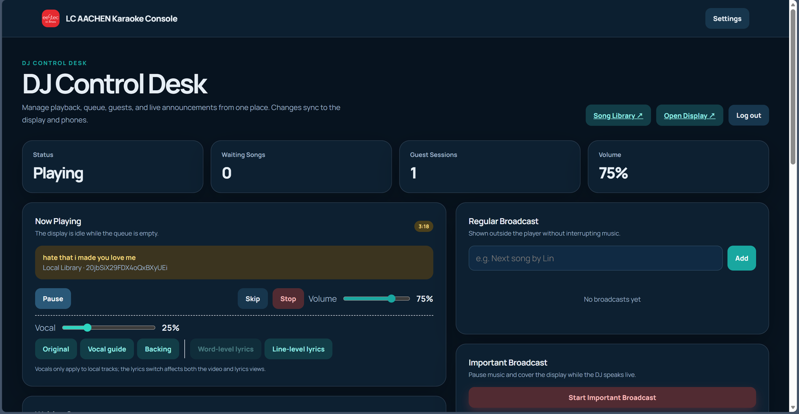
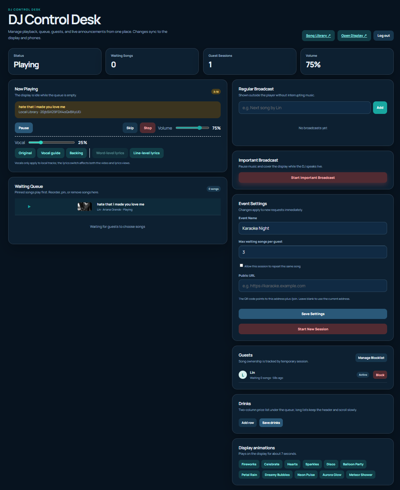
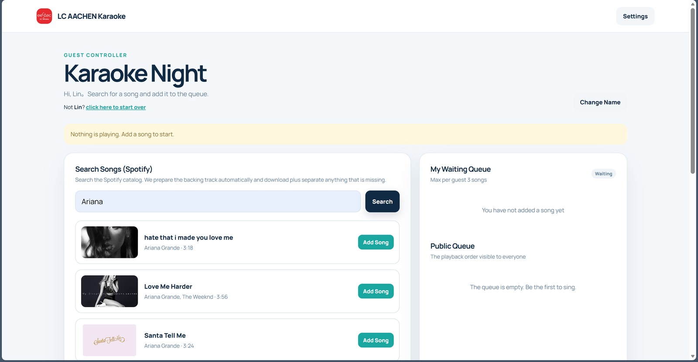

# Karaduoke · Live Karaoke System

**English** · [中文](README.zh-CN.md)

> [!CAUTION]
> **This README was generated by AI and is provided for reference only.**
> The human-written documentation is still in progress. Content here may be
> incomplete, outdated, or inaccurate — always verify against the actual code
> and configuration before relying on it.

> [!WARNING]
> **You must fill in your own API credentials before the app is fully functional.**
> They belong in `config\config.json` (created automatically on first launch) —
> or edit them in the control panel under **Settings**:
>
> | Field | Required for | What to enter |
> | --- | --- | --- |
> | `youtubeApiKey` | Mode A search (and mode B MV matching) | A YouTube Data API v3 key from [Google Cloud Console](https://console.cloud.google.com/) |
> | `spotify.clientId`<br>`spotify.clientSecret`<br>`spotify.redirectUri` | Mode B library management | Your own Spotify app credentials from the [Spotify Developer Dashboard](https://developer.spotify.com/dashboard) |
> | `spotify.refreshToken` | Mode B library management | Obtained by clicking **Sign in to Spotify** in the control panel |
> | `djPassword` | DJ console login (`/admin`) | Any password you choose — a random one is generated on first launch |
>
> Without `youtubeApiKey`, Mode A search returns no results.
> Without Spotify credentials, Mode B cannot search or import songs.
> **Never commit `config\config.json`** — it is already in `.gitignore`.

A dual-mode karaoke system. The two modes are **completely independent** — each can be
used on its own, or switched between from a single control panel.

The control panel (launcher) lives at the **project root** and manages both modes from
one shared configuration.

```
Karaduoke\
├─ start.cmd             Double-click to launch the control panel
├─ launcher\             Control panel (port 8787): launcher + UI + tunneling
├─ main.js               Unified service entry: loads the project for the active mode
├─ config\config.json    Control panel config (port, DJ password, API key, active mode)
├─ logs\                 Control panel runtime logs
├─ version.json          Control panel version
├─ docs\                 Documentation (previously karaoke_spo\docs, now merged here)
├─ karaoke_ytb\          Mode A · YouTube online (project)
├─ karaoke_spo\          Mode B · Local library (project)
└─ rubbish\              Files moved aside during cleanup; safe to delete
```

---

## Quick Start

Double-click **`start.cmd`** in the project root. The control panel opens at
**http://127.0.0.1:8787**

Pick a mode in the panel (dropdown at the top left) and click **Start Service**:

| Mode | Pages | URL |
| --- | --- | --- |
| B · Local library (default) | Display / DJ console / Guest / Library | http://localhost:3100/display ・`/admin` `/join` `/library` |
| A · YouTube online | Display / DJ console / Guest | http://localhost:3100/display ・`/admin` `/join` |

The two modes are **mutually exclusive** and share the same port (3100 by default).
After switching modes, click **Restart Service** to load the other project.

**Open Display** in the control panel opens `/display` in a separate Edge/Chrome window
with `--autoplay-policy=no-user-gesture-required`. The whole display page reuses a single
`AudioContext`: if the browser still demands a gesture, the page explicitly asks you to
"click once" — after unlocking, no further clicks are needed for the rest of the session.
When you open it manually in a normal tab, the first song usually needs one click.

The default DJ password lives in `config\config.json` and can be changed in the control
panel under **Settings** (applies to both modes at once).

> You can also run `node launcher\main.js` from the command line — same result as
> double-clicking the script.

---

## Screenshots

Captured from a running **Mode B · Local library** instance (v0.4.0). Browser tabs,
address bar and bookmarks are cropped out of the page screenshots; the originals live in `pic\`.

### Control panel



One page to start / restart / stop the service, switch modes, open the display, manage the
Python environment and edit credentials.

### Display · official MV + two-line lyrics



The muted official MV fills the screen with two-line lyrics on top; the right panel carries
the "scan to sing" QR code and the up-next queue.

### Display · Apple Music style + word-level lyrics



Album art with word-by-word highlighting; vocal level and original / guide / instrumental
switching are available right on the display.

### DJ console



Playback, queue, vocal mixing, broadcasts and live session settings. The full console view:

<details>
<summary>Expand full DJ console</summary>



</details>

### Guest request page



Guests search the Spotify catalogue on their own phone and add songs to the public queue.

---

## How the Two Modes Differ

| | Mode A · karaoke_ytb | Mode B · karaoke_spo |
| --- | --- | --- |
| Audio source | Streamed from YouTube | Local library (download + Demucs separation) |
| Vocal control | Not supported (pre-mixed track) | **Supported**: original / guide / instrumental, continuously adjustable |
| Word-level lyrics | Line-level | **Word-level** (QQ QRC + NetEase YRC) |
| Works offline | No | **Yes** (songs stored locally) |
| Playback view | YouTube player / lyrics | **Official YouTube MV (muted) + two-line lyrics** / Apple Music style |
| Disk usage | ~55 MB | ~7 GB |
| Dependencies | Node only, zero npm dependencies | Node + Python (demucs/torch) |

**Switching modes**: the **Mode** dropdown in the control panel writes `mode.active` in
`config\config.json`. Switching does **not** restart automatically — the service only
starts from the new project directory after you click **Restart Service**. This avoids
interrupting a live show mid-song.

---

## Directory Layout and File Locations

### Control panel (project root)

```
Karaduoke\
├─ start.cmd
├─ launcher\
│  ├─ main.js             Console service (127.0.0.1:8787)
│  ├─ config.js           Config read/write (config\config.json)
│  ├─ service.js          Start/stop/health-check the service process
│  ├─ environment.js      Runtime environment detection and installation
│  ├─ tunnel.js           cloudflared tunneling
│  ├─ logs.js             Log collection
│  ├─ i18n.js             UI strings (en / zh / de)
│  └─ ui\                 Console pages
├─ main.js                Unified service entry
├─ config\config.json     port / djPassword / youtubeApiKey / tunnel / mode.active
├─ logs\launcher-*.log
└─ version.json
```

`main.js` is the single entry point: the console runs `node <project root>\main.js` and
sets the working directory to the active mode's project directory; `main.js` then loads
that project's own entry point.

### Mode B (karaoke_spo)

```
karaoke_spo\
├─ main.js / server.js   Service itself (shares port 3100)
├─ lib\                  Lyrics sources, library DAL, preparation queue
├─ scripts\              Python pipeline (download / separate / lyrics / finalize)
├─ public\               Frontend (app.js / styles / player)
├─ python\               Library database helpers
├─ assets\
│  ├─ output\library\<spotifyId>\   Per-song artifacts
│  │  ├─ accompaniment.mp3   Instrumental
│  │  ├─ vocals.mp3          Isolated vocals (used by original/guide toggles)
│  │  ├─ guide.mp3           Guide track (lowered vocals)
│  │  ├─ original.mp3        Original mix
│  │                           (video is not stored locally: official YouTube MV streams muted)
│  ├─ covers\<spotifyId>.jpg        Album art
│  └─ lyrics\                       Lyric files
├─ data\
│  ├─ library.db         Library database (SQLite, metadata)
│  ├─ lyrics-overrides.json   Lyrics manually re-matched by the DJ
│  └─ state.json         Live state (queue / playback / settings)
└─ env\                  Runtime environment (Python, model cache, binaries) — see below
```

### Mode A (karaoke_ytb)

```
karaoke_ytb\
├─ main.js / server.js
├─ public\               Frontend
├─ lib\
└─ data\state.json       Live state
```

---

## Lyrics Source Priority

Mode B fetches lyrics in the following order, falling back only when the previous level fails:

```
① Manual re-match by the DJ (data/lyrics-overrides.json)
② Lyrics already stored in the library (no network)
③ QQ Music QRC (word-level, best)    —— soso search + musicu for encrypted QRC
④ NetEase Cloud YRC (word-level)     —— eapi encrypted endpoint
⑤ lrclib (line-level)
```

- **QQ**: the `musicu.fcg` search endpoint is now rate-limited by anti-bot protection
  (code=2001), so search goes through `c.y.qq.com/soso` instead. The lyric endpoint
  `GetPlayLyricInfo` still works. The returned QRC is encrypted and is decrypted by
  `lib/qrc-decrypt.js`.
- **NetEase Cloud**: word-level YRC requires eapi encryption plus an anonymous token;
  if unavailable, it falls back to line-level LRC.
- **lrclib**: line-level timestamps only.

If the stored lyrics are line-level but word-level was requested, an upgrade is attempted
in the **background** (without blocking current playback — the stored version is returned
first). The word-level version replaces it only when it arrives with a sensible line count
(≥ 8), so a bad match can't overwrite good lyrics. On success the override table is
updated and the cache refreshed, so the next playback uses word-level automatically.

---

## Hardware and Dependencies

| Item | Requirement |
| --- | --- |
| Node.js | ≥ 20 (tested on v24.22.1) |
| Python | Bundled in `env\python` (3.12, torch 2.13+xpu) |
| GPU | Intel Arc (XPU) supported; without a discrete GPU Demucs runs on CPU, 3–10× slower |
| Disk | Mode A ~55 MB, Mode B ~7 GB (songs plus Python environment) |

Model cache lives in `env\cache\` (torch 80 MB + huggingface 80 MB) and is used the first
time separation runs.

---

## Runtime Environment Directory (env)

Python, the model cache, and binary tools all live under `env\` at the project root and are
managed by the control panel's **Environment** button:

```
env\
├─ python\           Python virtual environment (Scripts\python.exe + site-packages)
├─ python-runtime\   Python itself (managed by uv)
├─ cache\            torch / huggingface / yt-dlp / uv caches
└─ bin\              ffmpeg.exe  ffprobe.exe  cloudflared.exe  uv.exe
```

Control panel → **Environment** lets you:

- See whether Python / ffmpeg / ffprobe / cloudflared are ready, plus cache usage
- Change directory locations (leave empty for `env\`; python / cache / bin can be set separately)
- **Install missing items**: binaries are downloaded directly; if Python is missing, an
  install script is generated
- Download individual items: ffmpeg + ffprobe, cloudflared
- **Preload models**: run Demucs model loading once to populate `env\cache`
- **Migrate an existing setup**: move things from the old layout
  (`karaoke_spo\python\.venv-xpu`, `karaoke_spo\.cache`, `karaoke_spo\data\bin`,
  `karaoke_ytb\bin`) into `env\` — move only, never delete
- Open the directory in Explorer

The Python environment is large (~5 GB), so the control panel does not run pip directly.
Instead it generates `setup-env.cmd` at the project root; double-click it to create the
venv and install torch (XPU) / demucs / yt-dlp. No preinstalled Python is required — the
script downloads Python via `uv` into `env\python-runtime\`.

> The dialog opens instantly: `/api/env` only checks existence (~5 ms), while directory
> sizes are measured asynchronously by `/api/env/sizes` and filled in afterwards, so the
> UI never blocks.

Configuration lives in the `env` section of `config\config.json` and is injected as
environment variables when the service starts:

| Variable | Purpose |
| --- | --- |
| `KARAOKE_ENV_DIR` | Environment root directory |
| `KARAOKE_PYTHON` | Python interpreter |
| `KARAOKE_BIN_DIR` / `KARAOKE_FFMPEG` / `KARAOKE_FFPROBE` | Binary tools |
| `TORCH_HOME` / `HF_HOME` | Model cache |

`env\` is in `.gitignore` and never enters version control.

---

## Spotify Credentials and Release Hygiene

Spotify's **Client ID / Client Secret / Redirect URI / Refresh Token** are all managed by
the control panel and stored in the `spotify` section of `config\config.json`; they are
**no longer written to `karaoke_spo\.env`**.

### Setup steps

1. Control panel → **Settings** → Spotify section; fill in Client ID / Secret / Redirect URI
2. The redirect URI must match the Spotify dashboard exactly. Recommended:
   `http://127.0.0.1:3100/api/spotify/callback`
   (the older `/api/spotify/auth/callback` is also accepted)
3. Click **Sign in to Spotify** → complete authorization in the browser → the panel detects
   and imports the authorization automatically
4. You can also paste a Refresh Token directly, or click **Import from service** to pull an
   existing authorization back into the panel

Credentials are injected as environment variables at service start; saving settings while
running pushes them immediately, no restart needed.

### Pre-release checklist

`config\`, `data\`, and `.env` are all in `.gitignore`, so a normal git release won't carry
them. If you package the entire directory, delete these — the project itself contains no keys:

```
config\config.json                    Control panel config (Spotify credentials, DJ password)
karaoke_spo\.env                      Spotify credentials (now empty)
karaoke_spo\data\spotify-token.json   Spotify authorization token
karaoke_spo\config\                   Legacy config (should already be in rubbish\)
```

A published copy generates a new DJ password on first launch; users must supply their own
Spotify credentials.

---

## Documentation

`docs\` contains the technical documentation:

- `architecture.md` / `architecture-modes.md` — Overall and dual-mode architecture design
- `library.md` — Library data model
- `lyrics-sources.md` — Lyrics source implementation details
- `lyrics-yrc-qq-fix.md` — QQ/YRC word-level lyrics fix log
- `background-download.md` — Background download and preparation queue
- `playback-dual-mode.md` / `playback-modes.md` — Video and Apple Music playback views
- `official-mv.md` — Official MV (`visualVideoId`) matching algorithm, DB fields, admin API, fallback logic
- `player-ui-spec.md` — Player UI specification
- `pipeline-mode-b.md` — Download and separation pipeline
- `vocal-mix.md` — Vocal mixing principles
- `使用说明.md` — End-user quick start (Chinese)
- `环境部署指南.md` — Step-by-step environment deployment guide (Chinese)
